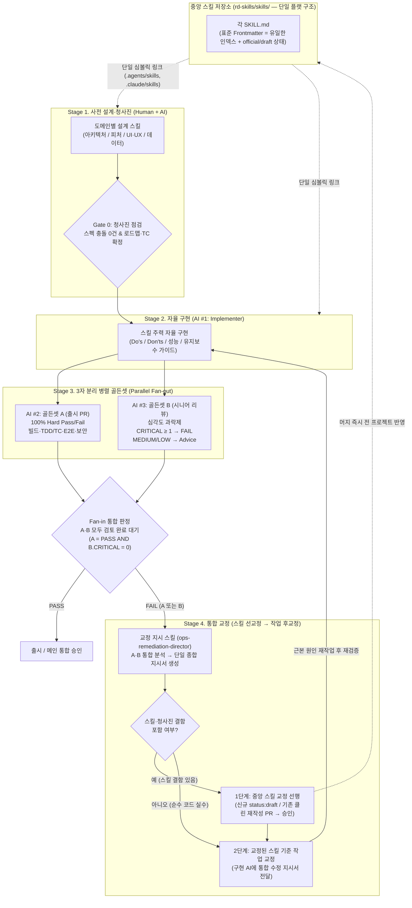

# R&D 스킬 기반 자율 개발 · 이중 골든셋 거버넌스 아키텍처

## 1. 설계 철학

이 아키텍처는 **사람의 개입은 ‘사전 청사진 확정’과 ‘스킬·출시 승인’ 양 끝단에 집중하고, 중간 구현은 스킬 기반으로 자율 주행시키며, 사후에는 3자 분리된 병렬 이중 골든셋과 ‘스킬 선교정 → 작업 후교정’ 피드백 루프로 품질을 끌어올리는 R&D 운영 체계**입니다.

1. **Agent Skills 표준 100% 준수**: 별도 커스텀 인덱스(`skills-index.yaml`)와 물리적 `drafts/` 폴더를 두지 않습니다. 모든 AI 런타임이 기본 스캔하는 `skills/<name>/SKILL.md`의 YAML frontmatter를 유일한 메타데이터 원본(SSoT)으로 삼습니다.
2. **독립 중앙 레포 + 단일 심볼릭 링크 배포**: 스킬은 독립 저장소(`rd-skills`) 1곳에서 관리하고, 각 프로젝트는 `.agents/skills`와 `.claude/skills`를 `rd-skills/skills`로 단일 심볼릭 링크 연결합니다.
3. **3자 분리 + 병렬 이중 골든셋(Fan-out / Fan-in)**: 구현 AI(`AI #1`), 골든셋 A 평가 AI(`AI #2`), 골든셋 B 시니어 리뷰 AI(`AI #3`)를 완전히 분리합니다. A와 B는 **동시에 병렬 실행**하고 **둘 다 검토가 끝난 뒤 결과를 합산**합니다.
4. **스킬 선교정 → 작업 후교정 (Reward Hacking 차단)**: 실패 시 테스트만 통과시키려고 코드부터 땜질하지 않습니다. A·B 결과를 통합 분석해 **스킬/청사진 결함이 있으면 먼저 스킬을 교정(Draft 등록 또는 개정 PR)한 뒤, 교정된 스킬 기준으로 작업을 교정**합니다.
5. **점진적 자동화**: 처음부터 무거운 오케스트레이션 시스템을 만들지 않고, **강한 가이드 + 표준 스킬셋 → 실전 보강 → 검증된 루틴의 스크립트/CI 자동화** 순으로 진화합니다.

---

## 2. 전체 파이프라인

---

## 3. 단계별 상세 구조

### Stage 1. 사전 논의 · 청사진 · 로드맵 (Human-in-the-Loop)
AI가 요구사항을 임의로 바로 구현하지 않고, 논의 주제에 맞는 설계 스킬을 조합해 청사진을 완성합니다.

* **도메인별 설계 스킬 (확장 대상)**:
  * `design-system-arch`: 시스템·모듈 경계, 패키지 의존성, 인프라 구조
  * `design-feature-spec`: 피처 요구사항 해체, 상태 머신, 예외·복구 흐름
  * `design-ui-ux`: 화면 위계, 행동 관계, 입력·전환 흐름, 사용자 문구
  * `design-data-model`: DB 스키마, 로컬/서버 동기화, 마이그레이션·보존 계약
* **Gate 0 (`gate-blueprint-check`)**:
  * 설계 산출물 간 모순·누락을 개발 착수 직전에 검증하고, 미결 의사결정(Open Decisions)을 0건으로 닫습니다.
  * Stage 2 자율 구현을 위한 작업 Slice 순서, 완료 조건(DoD), 골든셋 A용 핵심 TC 초안을 고정합니다.

### Stage 2. 자율 구현 · 작업 가이드 (AI #1: Implementer)
Gate 0을 통과하면 치명적 스펙 변경이 없는 한 사람의 개입 없이 자율 완주합니다.
* **스택별 구현 & 금지 가이드**: RN/Expo, Web, Server/Ktor, Supabase/Postgres 등 스택별 구현 정석(Do's)과 금지사항·성능 함정(Don'ts)을 스킬로 구비합니다.
* **앱별 도메인·시각 일관성**: 각 프로젝트/앱의 `AGENTS.md` 및 `docs/`가 해당 앱의 도메인 규칙과 시각 언어를 소유합니다.

### Stage 3. 3자 분리 병렬 이중 골든셋 (AI #2 & AI #3)
구현 AI(`AI #1`)와 완전히 분리된 두 독립 에이전트가 **동시에** 검증합니다.

* **AI #2 — 골든셋 A (`eval-release-pr-gate`, 100% Hard Pass/Fail)**
  * 정적·빌드(`typecheck`, `lint`, 정책 체크, 패키징)
  * 비즈니스 TDD 및 핵심 TC 100% 통과
  * 핵심 유저 플로우 E2E 및 필수 실기 동작 검증 (미관찰 항목은 `OPEN / UNVERIFIED`)
  * 치명적 보안(시크릿 노출, RLS/테넌트 격리 위반), 데이터 유실·크래시 0건
  * **판정**: 하나라도 깨지면 무조건 `FAIL`.
* **AI #3 — 골든셋 B (`eval-senior-quality-gate`, 심각도 과락제)**
  * 점수제(예: 99점 통과 시 치명적 결함 1건 누락) 대신 **심각도 기반 과락제**를 적용합니다.
  * **`CRITICAL` (1건 이상 → 즉시 `FAIL`)**: 보안 취약점, 데이터 손상·비동기 경합·원자성 파괴 위험, 아키텍처·네이티브 경계 근간 훼손, **골든셋 A 통과용 하드코딩·땜질(Reward Hacking) 징후**, 핵심 금지 규칙 무시.
  * **`MEDIUM` (조건부 `PASS` + Advice)**: 유지보수성 저하, 중복 로직, 경미한 성능 비효율, 앱 내 UI 톤·문구 일관성 미흡.
  * **`LOW` (`PASS` + Advice)**: 네이밍·가독성 개선 아이디어, 선택적 리팩터링 제안.

### Stage 4. 통합 교정 지시 및 스킬 선교정 (`ops-remediation-director`)
**반드시 골든셋 A와 골든셋 B의 검토가 모두 끝난 뒤** 실행됩니다.

1. **통합 근본 원인 분석**: A 리포트 + B 리포트 + 실제 diff/작업 경로를 한 번에 대조해 표면 증상이 아닌 근본 원인(Root Cause)을 분류합니다.
   * **스킬/청사진 결함**: 스킬이 모호하거나 금지 가이드가 누락되었거나 Gate 0 설계가 불완전했던 경우
   * **순수 코드 실수**: 스킬에 이미 명확히 적혀 있으나 구현 AI가 놓친 경우
2. **단일 종합 교정 지시서 발급**: 핑퐁을 막기 위해 A·B 이슈를 한꺼번에 해결하는 단일 지시서를 작성합니다.
3. **엄격한 교정 순서 — 스킬 교정 선행 → 작업 교정 후행**:
   * **1단계(스킬 교정)**: 스킬 결함이 포함되어 있으면 작업 코드를 먼저 고치지 않고, 중앙 `rd-skills` 레포에 **스킬 개정 PR**(신규 실험 스킬은 `metadata.status: draft`, 기존 정식 스킬은 클린 재작성 PR)을 먼저 생성해 사람 승인/활성화를 거칩니다.
   * **2단계(작업 교정)**: 교정된 스킬이 심볼릭 링크로 반영된 상태에서, 구현 AI(`AI #1`)가 **종합 교정 지시서 + 최신 스킬**을 바탕으로 코드를 근본 수정하고 Stage 3 병렬 골든셋을 재실행합니다.

---

## 4. Deferred ADR: 전사 공용 디자인 시스템 도입 시점

* **상태**: 보류됨 (Deferred — 실제 앱 출시 이후 도입)
* **배경**: R&D 속도와 UI 일관성을 위해 향후 전사 모노레포 기준의 공용 디자인 시스템을 두고 다른 앱 UI도 이를 기반으로 빠르게 적용하는 중간 지점으로 진화할 필요가 있음 (필요 시 `@app-automation/rn-foundation`의 UI 중립 경계 개정 포함).
* **결정**: 현시점에서 공용 디자인 시스템을 선제 구축하면 실제 제품 검증 전 과설계 위험이 크므로, **앱이 실제 출시되어 공통 UI 패턴이 검증된 이후에 도입**한다.
* **현재 적용 기준**: 도입 전까지 RN 앱 UI는 현행 `app-automation`의 `docs/rn-foundation-ui/README.md`(앱별 시각 자유도 + 최소 네이티브 오너십 경계) 기준을 그대로 따른다.

---

## 5. 워크플로우 하네스 및 프로젝트 CLI 제어 아키텍처 (Phase 2 대상)

스킬(`rd-skills`)이 충분히 검증된 뒤 자동화를 얹을 때는 **두꺼운 스킬(`rd-skills`) + 얇은 Go 하네스(`rd-harness`) + 표준 프로젝트 CLI 계약**의 3계층으로 결합합니다.

### ① 기술 스택 및 제어 경계
* **오케스트레이션 엔진**: **Go** 단일 바이너리 + SQLite (저메모리 상시 데몬, `errgroup` 기반 골든셋 A·B 병렬 실행, 프로젝트/레포 락, 상태 머신·Interrupt/Resume). 특수 분석/스크립트가 필요한 모듈만 Python 서브프로세스로 연결합니다.
* **단일 AI 실행 인터페이스 (`AgentExecutor`)**: LangChain/LangGraph 도입은 보류하고, Go 인터페이스 1개로 Gemini · Claude · Codex(코딩 CLI 및 모델 API)를 통일해 역할별 1줄 스위칭과 교차 검증을 지원합니다.
* **채팅 진입점 분리**:
  * **수신·송신부(Channel Gateway)**와 **내부 처리부(Chat Core)**를 완전 분리합니다.
  * 1차 채널은 **Telegram 프로젝트별 개별 채팅방 (`1 Chat = 1 Project`)**으로 격리 운영하고, 추후 Slack·Web UI·CLI와 상위 메인 오케스트레이터 뷰를 Gateway 어댑터로 확장합니다.
* **컨테이너 없는 1인 경량 격리**:
  * 서로 다른 레포는 병렬 허용, 같은 물리 Git 레포(예: 모노레포 내 여러 앱)는 `repo_lock_key`로 순차 제어합니다.
  * 실행(Run)별 산출물은 파일 기반(`runs/<run-id>/`)으로 저장하고, 골든셋 A(실행 권한)와 골든셋 B(`readOnly: true`)를 별도 OS 프로세스로 격리 실행합니다.

### ② 프로젝트 CLI 제어 계약 (CLI-Operable Project)
하네스(Go)와 AI가 프로젝트 내부 기술(RN·Web·Server)에 종속되지 않고 조작·보고할 수 있도록, 각 프로젝트는 표준 CLI 명령 계약(`rd-project.yaml`)을 노출합니다.
* **결정론적 직접 제어 (No-AI)**: `status`, `static_check`, `test`, `e2e`, `build_check`, `build_apk`, `ios_boot` 등 — Go 하네스가 직접 실행해 종료 코드·로그·아티팩트 경로를 즉시 보고.
* **지능형 작업 제어 (AI + Skills)**: `AgentExecutor`가 `rd-skills`를 주력으로 로드해 설계·구현·병렬 골든셋·교정 지시를 수행.
* **앱 개발 원칙**: 신규 앱·기능은 GUI 수동 확인에만 의존하지 않고, 핵심 검증·빌드·스모크 E2E를 CLI 1줄로 재현할 수 있게(CLI-Operable) 설계합니다.

---

## 6. 점진적 자동화 로드맵

1. **1단계 (표준 스킬 + 강한 가이드 — 최우선)**: 중앙 레포(`rd-skills`) 세팅, 프로젝트별 심볼릭 링크 연결, `AGENTS.md` 중요 경계 라우팅 배치, 핵심 스킬 실전 적용 및 CLI-Operable 습관화.
2. **2단계 (피드백 기반 스킬 정교화)**: 실제 R&D 과제 실패 사례를 **스킬 선교정 PR**로 축적·클린 재작성하고 `draft` → `official` 승격 사이클 정착.
3. **3단계 (Go 하네스 + Telegram 제어 구축)**: `AgentExecutor` + `rd-project.yaml` 실행기 + SQLite 상태 머신 + 프로젝트별 Telegram 채팅 Gateway 구축.
